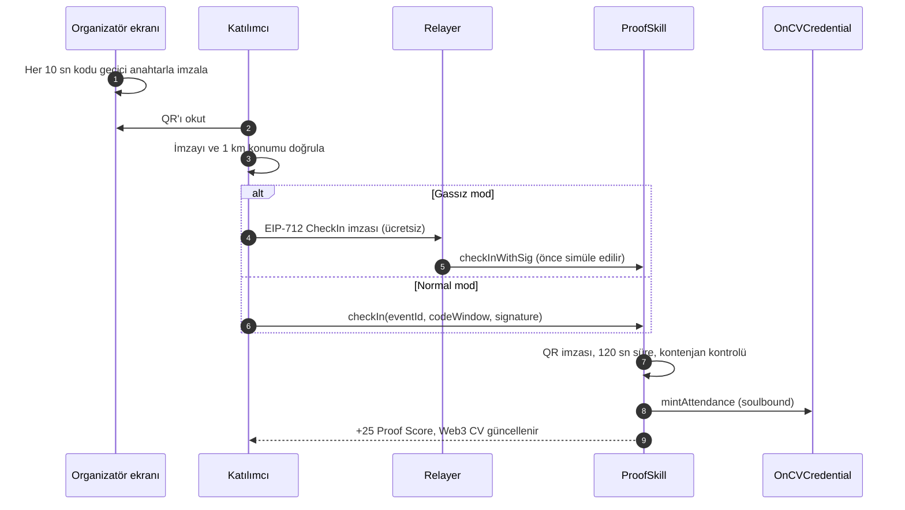
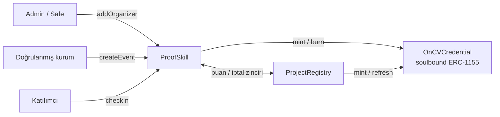

<p align="center">
  
</p>

<h1 align="center">onCV</h1>

<p align="center">
  <b>Verifiable On-Chain Credentials &amp; Attendance Infrastructure</b><br />
  Etkinlik katılımlarını Avalanche üzerinde doğrulanabilir kimlik bilgilerine ve paylaşılabilir bir Web3 CV'ye dönüştürür.
</p>

<p align="center">
  
  
  
  
</p>

<p align="center">
  <a href="https://oncv.xyz">oncv.xyz</a> ·
  <a href="#hızlı-başlangıç">Hızlı başlangıç</a> ·
  <a href="#yerel-demo">Yerel demo</a> ·
  <a href="#güvenlik-modeli">Güvenlik modeli</a>
</p>
<p>
  Hello
</p>
---

## Neden onCV?

Etkinlik katılım sertifikaları kolayca sahtelenir, hackathon projelerinin çoğu ise birkaç hafta içinde sessizce terk
edilir. İşverenler ve yatırımcılar ikisini de doğrulayamaz.

onCV bu iki sinyali zincire taşır:

- **Katılımın kanıtı:** Yalnızca admin tarafından doğrulanmış kurumlar etkinlik yayınlar. Katılımcı, organizatör
  ekranında her 10 saniyede yeniden imzalanan QR'ı okutarak check-in yapar. Ekran görüntüsü veya uzaktan paylaşılan
  link işe yaramaz.
- **Projenin yaşadığının kanıtı:** Hackathon projeleri 3. ve 6. ayda durumlarını zincire yazar. Organizatör, yatırımcı
  veya admin bu beyanları onaylar; kaçırılan kontrol noktası herkese görünür.

Her kayıt, cüzdanda görünen **devredilemez (soulbound) bir ERC-1155 token** ve tek linkle paylaşılan bir **Web3 CV**
olarak kalır.

## Özellikler

| | |
| --- | --- |
| **Doğrulanmış kurumlar** | Kurum adı ve domain'i admin tarafından zincire kaydedilir; organizatör başka bir kurumun adını kullanamaz. DNS TXT kaydıyla domain doğrulaması. |
| **Dinamik QR check-in** | Organizatör cihazındaki geçici anahtar QR'ı her 10 sn'de imzalar; kontrat 120 sn'den eski kodu reddeder. |
| **Konum doğrulaması** | Katılımcının etkinlik alanına 1 km içinde olduğu tarayıcıda kontrol edilir (online etkinliklerde atlanır). |
| **Gassız check-in** | Katılımcı yalnızca ücretsiz bir EIP-712 imzası atar; işlem ücretini relayer öder. Relayer kullanılamazsa işlem otomatik olarak katılımcının cüzdanından gönderilir. |
| **Kiosk modu** | Kamerası olmayan katılımcı kişisel QR'ını gösterir; organizatör cihazı okutup eş-imzalar. |
| **Soulbound kredansiyeller** | ERC-1155 + ERC-5192. Görsel ve özellikler (SVG + JSON) tamamen zincirde üretilir. |
| **Web3 CV** | Proof Score, seviye, beceri alanları, rozetler, projeler; LinkedIn'e sertifika olarak eklenebilir, zincirden üretilen paylaşım görseli. |
| **Proje takibi** | Davetle takım kurma, 3. / 6. ay kontrol noktaları, yetkiye göre onay, dinamik proje token'ı. |
| **Cüzdanlar** | OKX Wallet (önerilen), MetaMask, Coinbase, Rabby, WalletConnect; mobilde uygulama içi tarayıcıya deep-link. |

## Nasıl çalışır?



### Kontratlar



| Kontrat | Görev |
| --- | --- |
| [`ProofSkill.sol`](contracts/ProofSkill.sol) | Etkinlik ve katılım kaydı, doğrulanmış organizatörler (kurum profili), dinamik QR, gassız (EIP-712) ve kiosk check-in, kontenjan, online etkinlik, kayıt iptali |
| [`ProjectRegistry.sol`](contracts/ProjectRegistry.sol) | Hackathon sonrası proje takibi: davetle takım, 3. / 6. ay kontrol noktaları, yetkiye göre onay, yatırımcılar, moderasyon, iptal zinciri |
| [`OnCVCredential.sol`](contracts/OnCVCredential.sol) | Soulbound ERC-1155 (ERC-5192): katılım (`id = eventId`) ve proje (`id = 2^128 + projectId`) kredansiyelleri, zincirde üretilen dinamik metadata |

Kontratlar arası bağlantılar **tek seferliktir ve geri alınamaz** (`wireSatellites`, `setProjectRegistry`,
`setCredentialToken`): deploy sonrası admin dahil kimse token basımını veya puan yazımını başka bir adrese
yönlendiremez. Token kontratının admini yoktur.

## Teknolojiler

- **Kontratlar:** Solidity 0.8.24 (Cancun), OpenZeppelin 5, Hardhat
- **Frontend:** Next.js 15 (App Router), React 19, TypeScript, Tailwind CSS, Framer Motion
- **Web3:** wagmi 2, viem 2, RainbowKit 2, TanStack Query
- **Diğer:** Turf.js (mesafe), jsQR (kamera ile QR okuma), `next/og` (paylaşım görselleri), opsiyonel Upstash Redis
- **Ağ:** Avalanche Fuji C-Chain (chainId `43113`)

## Hızlı başlangıç

**Gereksinimler:** Node.js 20+, bir tarayıcı cüzdanı (OKX Wallet veya MetaMask) ve
[Fuji faucet](https://core.app/tools/testnet-faucet/?subnet=c&token=c)'ten alınmış test AVAX.

```bash
npm install
cp .env.example .env.local        # PowerShell: Copy-Item .env.example .env.local
npm run contracts:test            # 61 kontrat testi
npm run deploy:fuji               # PRIVATE_KEY gerekli; 3 kontrat deploy edilir, adresler config/deployment.json'a yazılır
npm run dev                       # http://localhost:3000
```

`deploy:fuji` kontratları deploy eder, birbirine bağlar, `config/abi.ts` ve `config/deployment.json` dosyalarını
günceller ve kaynak kodu SnowTrace'te doğrulamayı dener. Deploy eden cüzdan admin ve ilk doğrulanmış organizatör olur.

Başka bir kurumu doğrulamak için Enterprise Portal'daki admin panelini ya da şu script'i kullanın:

```bash
ORGANIZER=0xabc... ORG_NAME="Blockchain ITU" ORG_DOMAIN=blockchainitu.com npm run organizer:add
```

> Telefon kamerası, konum ve cüzdan deep-link'leri yalnızca **HTTPS** üzerinde çalışır. Telefonla denemek için
> uygulamayı yayınlayın (ör. Vercel) veya `NEXT_PUBLIC_APP_URL`'i HTTPS bir adrese ayarlayın.

## Yerel demo

Fuji'ye deploy etmeden, Fuji'nin chain id'sini (43113) kullanan yerel bir Hardhat zinciriyle her şeyi deneyebilirsiniz.

```bash
npm run demo:node      # 1. terminal: yerel zincir (açık kalsın)
npm run demo:setup     # 2. terminal: deploy + örnek veri + 3 test cüzdanı
npm run dev            # 3. terminal
```

`demo:setup` şunları hazırlar:

- **Kurum / Admin**, **Katılımcı** ve **Yatırımcı** test cüzdanları (anahtarlar ve cüzdan kurulum adımları
  `DEMO-WALLETS.local.md` dosyasında; gitignore'dadır)
- Katılımcı için iki hazır katılım kaydı ve bir "Demo Projesi"
- Gassız check-in için yerel bir relayer ve `.env.development.local`
- 120 saniyelik kontrol noktası aralığı: "3. ay" penceresi etkinlik bittikten ~1 dk sonra açılır

Fuji'ye dönmek için `.env.development.local` dosyasını silin ve `npm run deploy:fuji` çalıştırın.

### Demo akışı

1. **Enterprise Portal** → etkinlik oluştur → dinamik QR → **Sunum modu**.
2. Telefonla QR'ı okut → konum ve QR doğrulanır → **Claim & Verify Attendance** (gassız modda sadece imza).
3. Kamerası olmayan katılımcı: check-in sayfasında **Kişisel check-in QR'ı** → organizatör **Kiosk modu** ile okutur.
4. Başarı ekranında **Projeni kaydet** → proje sayfası ve dinamik token.
5. Kontrol noktası penceresi açılınca: durum gir → organizatör / yatırımcı onayla → token ve `/projects` anında güncellenir.
6. Web3 CV linkini paylaş: sosyal medyada zincirden üretilen önizleme görseli çıkar.

## Ortam değişkenleri

Tam liste ve açıklamalar: [`.env.example`](.env.example).

| Değişken | Açıklama |
| --- | --- |
| `PRIVATE_KEY` | Deploy/admin **test** cüzdanı. Yalnızca deploy için gerekir; Vercel'e eklenmez. |
| `ADMIN_ORG_NAME` / `ADMIN_ORG_DOMAIN` | Deploy eden kurumun etkinliklerde görünen adı ve domain'i |
| `ADMIN_TRANSFER_DELAY_SECONDS` | İki adımlı admin devrinin bekleme süresi (varsayılan 1 gün) |
| `CHECKPOINT_INTERVAL_SECONDS` | Proje takibi aralığı (varsayılan 90 gün). Canlı demo için `120` |
| `RELAYER_PRIVATE_KEY` + `NEXT_PUBLIC_GASLESS_CHECKIN=true` | Gassız ve kiosk check-in. Relayer ayrı, az miktarda Fuji AVAX'lı bir cüzdan |
| `RELAYER_MIN_BALANCE_AVAX` / `RELAYER_MAX_TX_PER_EVENT` / `RELAYER_DAILY_TX_LIMIT` | Relayer harcama sınırları; aşılınca istemci normal işleme döner |
| `UPSTASH_REDIS_REST_URL` / `_TOKEN` | Opsiyonel: hız sınırları, bütçe ve relayer kilidi tüm sunucu örneklerinde ortak olur |
| `NEXT_PUBLIC_WALLETCONNECT_PROJECT_ID` | OKX/MetaMask mobil QR bağlantısı için (ücretsiz: https://cloud.reown.com) |
| `NEXT_PUBLIC_APP_URL` | Yayındaki HTTPS adres. Boş bırakılırsa sayfanın kendi adresi kullanılır |
| `RPC_UPSTREAM_URL` + `NEXT_PUBLIC_RPC_PROXY=true` | Opsiyonel: özel RPC anahtarı sunucuda kalır, tarayıcı `/api/rpc` üzerinden okur |

> `NEXT_PUBLIC_` ile başlayan değişkenler tarayıcıya gömülür. Özel anahtarları asla bu önekle tanımlamayın.

## npm script'leri

| Script | Ne yapar |
| --- | --- |
| `npm run dev` | Geliştirme sunucusu (Turbopack) |
| `npm run build` / `npm start` | Production build ve sunucu |
| `npm run lint` / `npm run typecheck` | ESLint ve TypeScript kontrolü |
| `npm run contracts:compile` / `contracts:test` | Kontratları derle / 61 Hardhat testini çalıştır |
| `npm run contracts:abi` | Kontrat değişince `config/abi.ts`'i yeniden üret |
| `npm run deploy:fuji` | Fuji'ye deploy + bağlama + frontend config + SnowTrace doğrulama |
| `npm run organizer:add` | Kurum profiliyle organizatör doğrula (`REVOKE=true` ile kaldır) |
| `npm run admin:transfer` | İki adımlı admin devri (ör. bir Safe multisig'e) |
| `npm run demo:node` / `demo:setup` | Yerel demo zinciri ve örnek veri |

## Güvenlik modeli

- **Kurum profili:** `addOrganizer(address, name, domain)`. Etkinliklerde organizatör adı bu kayıttan gelir; bir
  organizatör başka bir kurumun adını kullanamaz. Admin, kurumun domain'inde `oncv-verify=<cüzdan>` TXT kaydını
  panelden kontrol eder (`/api/verify-domain`).
- **Admin sınırı:** Admin etkinlikleri durdurabilir ve kayıt iptal edebilir, ancak QR imza anahtarını değiştiremez ve puan
  yazamaz; yani hiçbir kurum adına katılım üretemez. Admin yetkisi iki adımlı ve gecikmeli devredilir
  (`npm run admin:transfer`, ör. bir Safe multisig'e).
- **Dinamik QR:** Organizatör cihazındaki geçici anahtar kodu her 10 sn'de imzalar; kontrat 120 sn'den eski kodu reddeder.
  Anahtarlar etkinlik bitiminden 1 gün sonra cihazdan silinir.
- **Konum:** 1 km sınırı istemcide (tarayıcıda) uygulanır; zincirdeki asıl güvence imzalı ve kısa ömürlü QR kodudur.
- **Kiosk modu:** Katılımcı ücretsiz bir onay imzasını (5 dk geçerli) kişisel QR olarak gösterir; organizatör cihazı okutup
  etkinliğin QR anahtarıyla eş-imzalar. Kontrat iki imzayı da doğrular.
- **Geriye tarihleme:** Etkinlik en fazla 1 saat geriye tarihlenebilir; eski etkinlikler sonradan yaratılıp katılım
  üretilemez.
- **İptal:** `revokeCredential` token'ı yakar, puanı geri alır, kişiyi proje takımından çıkarır ve kazandığı proje
  puanlarını geri alır; kayıt zincirde "iptal edildi" olarak kalır.
- **Proje onayı:** "Yatırım aldı" yalnızca doğrulanmış yatırımcı veya admin; diğer durumlar etkinliğin organizatörü
  tarafından da onaylanabilir. Takım üyeleri kendi projesini onaylayamaz. Puanlar yalnızca ileri yönde ve bir kez verilir
  (kümülatif 10 / 35 / 85); durum değiştirip tekrar onaylatarak puan toplanamaz.
- **Sayfalama:** Tüm listeler sayfalanır (`getLatestEvents`, `getUserCredentials`, `getEventAttendees`, `getProjects`).
- **Gassız relayer:** İstek önce simüle edilir (hatalı istek gas harcatmaz), gönderimler nonce sırasıyla tek tek yapılır,
  IP / katılımcı / etkinlik başına hız sınırı ve etkinlik / günlük bütçe vardır. Relayer kullanılamazsa istemci
  işlemi katılımcının cüzdanından gönderir. Durum: `GET /api/relay/check-in?eventId=…`.
- **HTTP header'ları:** clickjacking (`frame-ancestors 'none'`), MIME sniffing ve referrer sızıntısına karşı; ayrıca
  sıkı bir CSP **report-only** modunda toplanır (`/api/csp-report`).

## Proof Score

Puanları yalnızca kontratlar yazabilir; iptal edilen kayıtların puanı geri alınır.

| Kaynak | Puan |
| --- | --- |
| Doğrulanmış her katılım | +25 |
| Onaylanan proje ilerlemesi (takımın her üyesine, kümülatif) | Hâlâ aktif 10 · İlk müşteri 35 · Yatırım aldı 85 |

| Seviye | Newcomer | Explorer | Contributor | Builder | Senior Builder | Web3 Builder |
| --- | --- | --- | --- | --- | --- | --- |
| **Puan** | 0 | 25 | 50 | 100 | 175 | 250 |

## Proje takibi (hackathon sonrası)

1. Katılımcı check-in sonrası **Projeni kaydet** (veya organizatörün gösterdiği kayıt QR'ı) ile projeyi kaydeder ve takım
   arkadaşlarını **davet eder**; davet edilenler kabul edince takıma katılır (etkinlik bitiminden sonra 7 gün açık,
   en fazla 5 kişi).
2. Her takım üyesi projenin soulbound token'ını alır.
3. **3. ve 6. ayda** (etkinliğin bitişinden itibaren) proje sahibi durumu ve isteğe bağlı bir kanıt linkini girer:
   Hâlâ aktif / İlk müşteri / Yatırım aldı / Kapandı.
4. Yetkili kişi beyanı onaylar; takımın her üyesi toplamda 10 / 35 / 85 Proof Score'a kadar puan alır.
5. Pencerede güncelleme girilmezse kontrol noktası **Kaçırıldı** olur ve proje "Sessiz" görünür. "Büyüyor" etiketi için
   ilk müşteri / yatırım beyanının onaylı olması gerekir.
6. Token görseli ve özellikleri (Stage, Verification, Checkpoint 3M/6M) zincirde üretildiği için kendiliğinden güncellenir.

`/projects` sayfası 3. ay hayatta kalma oranını, onaylı yatırımları ve sessiz projeleri gösterir.

## Sayfalar

| Sayfa | İçerik | Arama motoru |
| --- | --- | --- |
| `/` | Tanıtım, canlı istatistikler, son etkinlikler | indexlenir |
| `/check-in` | QR okutma, check-in akışı, kişisel kiosk QR'ı | indexlenir |
| `/projects` | Hackathon sonrası projeler ve hayatta kalma oranı | indexlenir |
| `/projects/[id]` | Proje takibi, güncellemeler, onaylar, dinamik token | indexlenir (gizlenen projeler hariç) |
| `/[address]`, `/profile/[address]` | Herkese açık Web3 CV (kısa paylaşım linki) | indexlenir, canonical kısa link |
| `/profile` | Bağlı cüzdanın kendi Web3 CV'si | noindex |
| `/projects/new` | Proje kaydı | noindex |
| `/organizer` | Enterprise Portal: etkinlikler, dinamik QR, kiosk, admin konsolu | noindex, robots.txt'de kapalı |

Organizatör ve admin araçları sağ üstteki **Enterprise Portal** butonunun arkasındadır. Erişim zincirdeki doğrulama
kaydına göre verilir; doğrulanmamış bir cüzdan **"Kurumsal doğrulama gereklidir"** ekranını görür ve oradan doğrulama
talep eder.

## Proje yapısı

```
contracts/                        ProofSkill, ProjectRegistry, OnCVCredential (+ interfaces/, test/ mock cüzdanlar)
scripts/deploy.js                 3 kontrat + tek seferlik bağlama + frontend config + SnowTrace doğrulama
scripts/add-organizer.js          Kurum profiliyle organizatör doğrulama / kaldırma
scripts/transfer-admin.js         İki adımlı admin devri (Safe'e)
scripts/demo-node.js, local-demo.js   Yerel demo zinciri ve örnek veri
test/                             61 Hardhat testi (denetim bulguları için regresyon testleri dahil)
app/api/relay/check-in            Gassız / kiosk check-in relayer'ı + sağlık durumu
app/api/rpc                       Salt-okunur JSON-RPC proxy'si
app/api/verify-domain             DNS TXT domain doğrulaması
app/api/csp-report                CSP report-only raporları
app/organizer/                    Enterprise Portal (organizatör + admin konsolu)
app/projects/                     Proje listesi, kayıt ve takip sayfaları
app/**/opengraph-image.tsx        Paylaşım linki önizleme görselleri (kök kart dahil)
app/robots.ts, sitemap.ts, manifest.ts   Arama motoru ve PWA metadata'sı
components/                       Arayüz bileşenleri (landing, checkin, organizer, profile, projects, ui)
config/                           Zincir, kontrat adresleri, ABI, wagmi ve marka ayarları
lib/                              QR imzalama, oturum anahtarları, konum, hata mesajları, proje / beceri mantığı
lib/server/                       Sunucu tarafı RPC istemcisi, relayer ve hız sınırlayıcı
public/brand/                     Logo dosyaları
```

<details>
<summary><b>Arayüz, marka ve metadata standartları</b></summary>

**Metadata.** Kurallar `app/layout.tsx` başındaki açıklamada: sayfalar yalnızca başlık / açıklama / canonical / robots
tanımlar; Open Graph ve Twitter başlıkları bunlardan otomatik doldurulur, paylaşım görseli en yakın `opengraph-image`
dosyasından gelir. `app/robots.ts`, `app/sitemap.ts` ve `app/manifest.ts` aynı standarda uyar.

**Logo.** Logo kırmızı pandadır (`public/brand/oncv-mark.png`, şeffaf arka planlı 512 px; navbar için
`oncv-mark-128.png`). Favicon `app/icon.png`, iOS ikonu `app/apple-icon.png` (koyu zeminli) aynı görselden üretilir;
paylaşım kartları (`lib/og.tsx`) logoyu ve logo kırmızısı üst çizgiyi kullanır. Marka sabitleri: `config/brand.ts`.

**Renkler.** Tek vurgu ailesi logodan alınan `brand` renk skalasıdır (`tailwind.config.ts`):

| Token | Renk | Kullanım |
| --- | --- | --- |
| `brand-200` | `#FD9D7C` | şeftali (kulak, kuyruk) |
| `brand-300` | `#F56B54` | mercan |
| `brand-400` | `#EE5448` | koyu zeminde kırmızı metin (5.7:1 kontrast) |
| `brand-500` | `#DD3136` | ana kırmızı: vurgu butonu, odak halkası, durum noktası |
| `brand-600` | `#B31133` | koyu kırmızı: hover ve kenarlık tonları |
| `brand-700` | `#860423` | en koyu ton |

Birincil buton beyaz kalır, hover'da şeftaliye döner; ikincil butonlar ve kartlar hover'da logo kırmızısı kenarlık alır;
odak halkası ve form alanlarının odak kenarlığı `brand` tonlarındadır. Avalanche logosu kendi kırmızısını (`#E84142`)
korur.

</details>

---

<p align="center">
  <sub>Avalanche Fuji Testnet üzerinde çalışır. Test ağı içindir; gerçek varlık kullanmayın.</sub>
</p>
